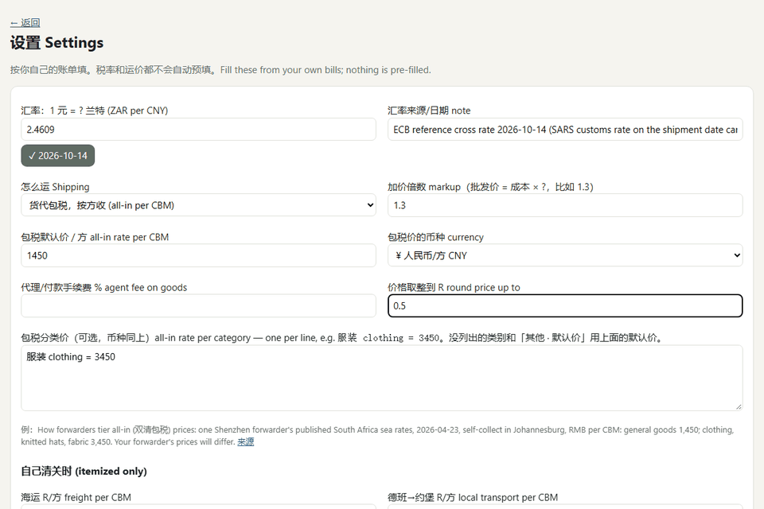

# Landed Cost · 落地成本

Photo of a Yiwu supplier's delivery note → landed cost per piece in rand → wholesale price per bale.
Two local open-weight vision models (Gemma 4 via Ollama) read the table; code checks every number and does the maths.
Photos, prices and settings never leave the computer.

Built for the [DEV Hacktoberfest Open-Source AI Challenge, Week 2: Side Hustle](https://dev.to/challenges/hacktoberfest-week2-2026-10-12).



*The photo is a synthetic test document (watermarked 样例 SAMPLE). The shipping rates in the demo are one forwarder's
published example rates, not anyone's real prices.*

## What it does

1. **Read** a phone photo of a 送货单 (delivery note) or 装箱单 (packing list): style code, name, pieces per bale,
   bales, quantity, unit, unit price, amount, carton size, volume, the printed totals.
2. **Check every number in code**: pieces/bale × bales = quantity, quantity × price = amount, rows add up to the
   printed 合计, row volumes add up to the printed total volume, no carton is the size of a room. Anything that doesn't
   add up is red; the owner fixes it in place, and can add a row the model missed.
3. **Cost it**, either way goods actually arrive:
   - **all-in (包税)**: a forwarder's door-to-door, duty-inclusive price per cubic metre, optionally per category
     (clothing usually costs more per m³ than general goods);
   - **itemized**: freight per m³ + customs duty on the FOB value + import VAT + this note's share of the shipment's
     clearing fee.
4. **Suggest a wholesale price** per piece (or per 打 / dozen when the note is priced that way) and per bale, and write a
   short summary to paste into WhatsApp, with every unresolved warning in it.

A missing number never silently becomes 0 in a cost: a row either gets a full cost, a cost with an explicit warning,
or an error and no price.

## How the reading works

```
photo ──► Gemma 4 12B (local) ──► check() ── all good ──────────────────────────────► rows
                                     │
                                     └─ flagged rows ──► Gemma 4 E4B (local) ──► check()
                                          take its numbers for a flagged row only if that row is complete, passes every
                                          check, and the totals get no worse; shown in yellow so the owner looks
```

The models only transcribe (JSON-schema output through Ollama, temperature 0, thinking off). Code does every
calculation. Field order in the schema matters: the models fill it left to right like table columns, so extra fields
(carton number, unit) come last. Putting the carton number first once shifted every value one column over.

### Measured accuracy (synthetic documents)

Two sets of 8 synthetic documents with known answers: printed and handwriting-style delivery notes, phone-photo
distortion, packing lists with carton numbers and per-row volume, a note with no amount column, a 12-row list.
The prompt and merge rules were tuned while looking at the first set; the second set was generated afterwards with a
different seed and run once.

| Reader | Tuning set: numbers right | silent errors | Held-out set: numbers right | silent errors | Median time |
|---|---|---|---|---|---|
| **12B, then E4B on flagged rows (the app)** | **100%** | **0** | **100%** | **0** | 6–10 s |
| Gemma 4 12B alone | 88.8% | 0 | 100% | 0 | ~6 s |
| Gemma 4 E4B alone | 99.6% | 1 | 86.9% | 0 | ~4 s |

268 numeric fields per set. A *silent error* is a wrong number that no check flagged, the kind that would reach a
price. **Not yet measured on real supplier paperwork.** Reproduce: `python tests/fixtures/make_testset.py <dir> [seed]`,
then `python tests/eval_extract.py <dir> "gemma4:12b+gemma4:e4b" gemma4:12b gemma4:e4b`.

## South African import rules used (reference, not tax advice)

- Customs duty is charged on the **FOB** value (price at the port of export, including inland freight in China);
  international freight and insurance are excluded only if shown separately and documented.
  [SARS valuation policy](https://www.sars.gov.za/sc-cr-a-05-method-1-valuation-of-imports-external-directive)
- Import VAT = 15% × (customs value + 10% + duty); a VAT-registered importer can claim it back.
  [SARS](https://www.sars.gov.za/faq/faq-how-is-vat-calculated-on-imported-goods/)
- A one-click **reference** duty table from the SARS Schedule 1 Part 1 tariff book dated 2026-08-28 (General rate, which
  applies to goods from China): e.g. cotton socks 45%, knitted pyjamas 40%, textile tablecloths 30%, rubber hot water
  bottles free. It is never applied automatically, because the right rate depends on classification. See `lc/reference/`.
- Optional exchange-rate fill from the ECB's free daily reference rates (the only network call, only on click).

## Run it

Requirements: Python 3.11+ (tested on 3.13), [Ollama](https://ollama.com), a GPU with ~10 GB free for the 12B model
(it also runs on CPU, slowly).

```bash
ollama pull gemma4:12b
ollama pull gemma4:e4b
python -m venv .venv
.venv/Scripts/pip install -r requirements.txt      # Linux/macOS: .venv/bin/pip
.venv/Scripts/python app.py                        # open http://127.0.0.1:8810
```

Then fill **Settings** (exchange rate, how you ship, your rates, markup) and upload a photo.
`LC_MODEL` / `LC_SECOND_MODEL` change the models; `LC_DATA` changes where data is kept.

## Tests

`python -m pytest -q`: 58 behaviour tests, no model needed. Every bug found in review has its own test: no silent
zero shipping or price, Save keeps row volumes, the second read can't swap in a wrong row or a worse total, duplicate
codes, per-dozen units, number formats like `2,46` and `１２０`, cross-site POSTs refused, corrupt settings recovered,
browsers' unsafe ports avoided, the word "null" from a model treated as empty, a crashed cold model load retried.

## What runs where

| Piece | Where | Network |
|---|---|---|
| Photos, rows, prices, settings | `data/` on this computer | never |
| Gemma 4 12B + E4B | local Ollama | model download once |
| Exchange rate | ECB public XML | only when you click the button |

## Credits

- [Gemma 4](https://ai.google.dev/gemma) by Google (Apache 2.0), served by [Ollama](https://ollama.com)
- SARS public documents for the reference rates; ECB euro foreign exchange reference rates
- Flask, Pillow, Playwright (only to generate the synthetic test documents)
- Code written with help from Claude Code (an AI coding agent)

MIT License.
